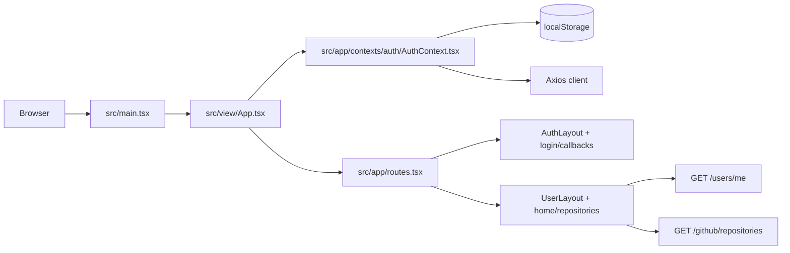

# Arquitetura

## Contexto arquitetural

O projeto e uma SPA front-end para o produto Nexo. O repositorio contem apenas a camada cliente; nao foram identificados backend, banco de dados, filas, workers ou infraestrutura de deploy neste codigo.

O fluxo principal e autenticar o usuario por Google ou GitHub, manter a sessao com `refreshToken`, consultar os dados do usuario logado e exibir a area de repositorios GitHub.

## Estilo arquitetural

- SPA renderizada no cliente.
- Roteamento por `react-router-dom`.
- Segmentacao de paginas com `React.lazy` e `Suspense`.
- Estado de servidor com `@tanstack/react-query`.
- Estado de sessao encapsulado em `AuthProvider` + `localStorage`.
- Camada de servicos HTTP centralizada em `src/app/services`.

## Entrada da aplicacao

- `src/main.tsx`: monta `App` em `#root` e importa listeners globais e estilos.
- `src/view/App.tsx`: compoe `ErrorBoundary`, `BrowserRouter`, `QueryClientProvider`, `AuthProvider`, rotas e toaster.
- `src/app/routes.tsx`: define as rotas publicas e privadas.

## Estrutura principal

- `src/app`: configuracao, constantes, hooks, contexto de auth, servicos e utilitarios.
- `src/view`: paginas, layouts, componentes reutilizaveis e CSS global.
- `src/view/components/ui`: componentes base de interface.
- `src/app/assets`: imagem, video e icones estaticos.

## Fluxo de autenticao

1. O usuario clica em Google ou GitHub na tela de login.
2. O front chama o backend via `AuthService` em `/auth/google` ou `/auth/github`.
3. O backend devolve `auth_url`.
4. O navegador e redirecionado para a URL externa.
5. O callback recebe `refreshToken` na query string.
6. `AuthProvider` salva o `refreshToken` no `localStorage`, registra o handler de refresh e carrega `/users/me`.
7. Se ja existir token salvo, o provider tenta reestabelecer a sessao ao iniciar.

## Autorizacao e acesso

- `AuthLayout` redireciona usuario ja autenticado para `/home`.
- `UserLayout` redireciona usuario nao autenticado para `/login`.
- O estado `signedIn` e derivado da resposta de `useMe`.
- A area de repositorios depende de `me.is_github_app_installed`.

## Estado e cache

- `queryClient` foi configurado com `retry: false` e `refetchOnWindowFocus: false` para queries.
- Mutations tambem nao fazem retry por padrao.
- `AuthTokensManager` salva somente `refreshToken` em `localStorage`; o `access_token` retornado pelo backend nao e persistido no codigo atual.
- O cache do React Query e limpo no sign out.

## Comunicacao entre componentes

- `AuthProvider` orquestra login, logout, refresh de token e carregamento de `me`.
- Hooks de query/mutation encapsulam chamadas especificas da camada de servicos.
- Paginas consomem `useAuth`, `useMe` e `useGetGitHubRepositories`.
- Componentes visuais recebem os dados prontos e cuidam da apresentacao.

## Integracoes centrais na arquitetura

- API base configurada por `VITE_BASE_API_URL`.
- Requisicoes Axios usam `withCredentials: true`.
- Interceptor de resposta tenta renovar sessao em `401`, exceto quando a requisicao e a do refresh.
- Link externo para instalacao do GitHub App em `https://github.com/apps/app-nexo-AI/installations/new`.

## Areas criticas e riscos conhecidos

- Existe uma divergencia no interceptor: ele ignora `/auth/refresh-token`, mas o cliente chama `/auth/refresh-tokens`. Se o endpoint de refresh retornar `401`, isso pode provocar tentativa de refresh repetida.
- Nao foi encontrado provider global de tema, apesar de `next-themes` ser consumido pelo toaster.
- A rota `/configuration` aparece na navegacao, mas nao ha pagina correspondente registrada nas rotas.
- O callback de login navega para `/home` logo apos disparar a inicializacao da sessao; a conclusao do `setupAuth` ocorre assincronamente.

## Caminhos relevantes

- [src/main.tsx](../src/main.tsx)
- [src/view/App.tsx](../src/view/App.tsx)
- [src/app/routes.tsx](../src/app/routes.tsx)
- [src/app/contexts/auth/AuthContext.tsx](../src/app/contexts/auth/AuthContext.tsx)
- [src/app/services/Services.ts](../src/app/services/Services.ts)
- [src/app/services/AuthService.ts](../src/app/services/AuthService.ts)
- [src/app/services/UserService.ts](../src/app/services/UserService.ts)
- [src/app/services/GitHubService.ts](../src/app/services/GitHubService.ts)
- [src/view/pages/\_Layouts/AuthLayout.tsx](../src/view/pages/_Layouts/AuthLayout.tsx)
- [src/view/pages/\_Layouts/UserLayout.tsx](../src/view/pages/_Layouts/UserLayout.tsx)
- [src/view/pages/User/Repositories/index.tsx](../src/view/pages/User/Repositories/index.tsx)

## Quando atualizar este documento

Atualize este arquivo quando houver mudancas em estrutura, modulos, comunicacao, banco, infraestrutura, autenticacao, integracoes arquiteturais ou decisoes estruturais.
